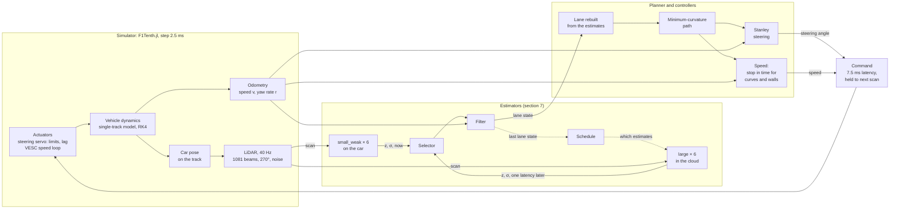
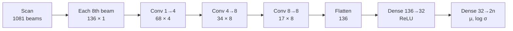
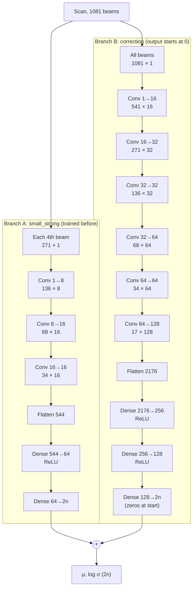
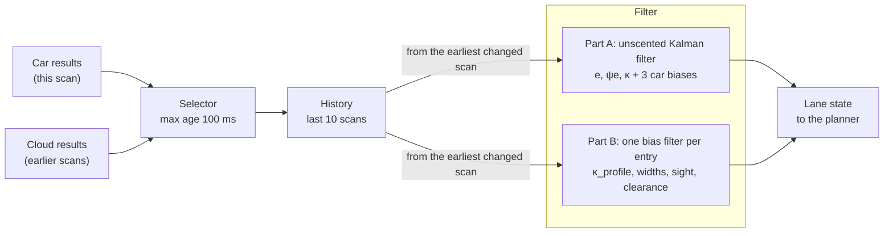
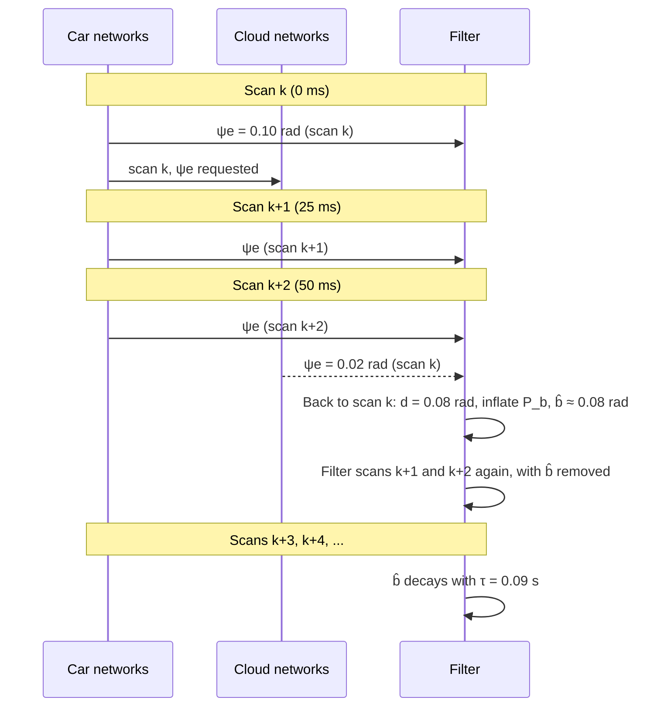

# Edge and cloud lane estimation: results

This file summarizes the work on this branch (`dnn-estimators`): the car's networks (`small_weak`), the cloud's networks (`large`), and how the car combines them. The full tables are in:

- [LidarLaneNets.jl/train/results/networks.md](LidarLaneNets.jl/train/results/networks.md): cost and accuracy of each network;
- [LidarLaneNets.jl/train/results/errors.md](LidarLaneNets.jl/train/results/errors.md): the error distributions;
- [LidarRacer.jl/scripts/results/compare-small_weak.md](LidarRacer.jl/scripts/results/compare-small_weak.md): the race results, with 95% confidence intervals.

A third set, `small_strong`, was also trained. Each `large` network is built on a `small_strong` network (section 3.3), but `small_strong` is not used on the car. Its numbers are in the full tables only.

## 1. The setup

- Two network sets estimate the lane from one LiDAR scan:
  - **small_weak** runs on the car (the edge). It runs on each scan.
  - **large** runs in the cloud. The car calls it for each estimate, when a schedule tells it to.
- Each set has six networks, one for each estimate:
  - `e`: the cross-track error at the front axle.
  - `ψe`: the heading error.
  - `κ_profile`: the curvature of the lane ahead, from 0 m to 8 m.
  - `widths`: the free room to the left and to the right, from 0 m to 8 m.
  - `sight`: how far ahead the car can see the lane (maximum 10 m).
  - `clearance`: the free distance along 13 arcs ahead.
- Each network gives a value and its own standard deviation $\sigma$.
- We trained on the true values from the map, not on the hand-written estimator.
- The tracks are in three groups:
  - Training: 16 tracks.
  - Validation: Hockenheim and Sepang.
  - Test: Spa, Monza, Silverstone, Oschersleben and YasMarina. The networks never saw these tracks.

The full control loop. The car sees the track only through the LiDAR. It never gets its pose or the map.

One turn of the loop:

1. The simulator moves the car with the commands that are active. It steps each 2.5 ms.
2. Each 25 ms, the LiDAR gives a scan. The odometry gives the speed $v$ and the yaw rate $r$ (the true values, without noise).
3. The estimators give the lane state (section 7).
4. The planner rebuilds the lane ahead from the lane state. It removes a safety margin from the widths. It removes $1\sigma$ from `sight` and `clearance`.
5. The planner finds the minimum-curvature path through the lane.
6. The Stanley controller calculates the steering angle that follows this path.
7. The speed is the highest speed from which the car can brake in time. It must reach each curve it sees slowly enough for the lateral acceleration limit, and it must stop before a wall ahead.
8. The commands take effect 7.5 ms after the scan. They stay active until the next commands. Then the loop starts again at step 1.

If the filter loses the lane, the car brakes to a stop and keeps its steering angle.

## 2. Cost

| | small_weak (car) | large (cloud) | Ratio |
|---|---|---|---|
| LiDAR beams in | 136 (every 8th beam) | 1081 (all beams) | 8× |
| MACs per scan, all six networks | 0.11 M | 25.5 M | 238× |
| Parameters, all six networks | 37 k | 4.29 M | 116× |
| Time for one network, CPU | 0.03 ms | 0.27 ms | 9× |

Each large network is a `small_strong` network plus a correction. The correction starts at zero. Thus a large network is never less accurate than its small_strong base on the validation tracks.

## 3. Network architecture

All 12 networks are 1D convolutional networks over the LiDAR scan. Each set has one network for each estimate. In a set, the six networks are the same. Only the output layer is different.

### 3.1 Common to all 12 networks

- **Input:** the range $r_i$ of each beam, scaled to 0 to 1. The scan has 1081 beams over 270° (0.25° between beams).

$$
u_i = \begin{cases} r_i / 10\ \text{m} & 0 < r_i \le 10\ \text{m} \\ 1 & \text{otherwise (too far, or not valid)} \end{cases}
$$

- **Convolutions:** kernel 5, stride 2, "same" padding, ReLU. Each convolution halves the length.
- **Hidden dense layers:** ReLU.
- **Output layer:** linear, with $2n$ outputs: $n$ normalized means $\tilde\mu_j$, then $n$ normalized log standard deviations $\ell_j$.
- **Back to physical units:** $m_j$ and $s_j$ are the mean and the standard deviation of entry $j$ in the training data and its mirror image.

$$
\mu_j = m_j + s_j\,\tilde\mu_j, \qquad \sigma_j = s_j \exp\!\big(\operatorname{clamp}(\ell_j,\,-6,\,3)\big)
$$

- There is no batch normalization and no dropout.

Output size $n$ for each estimate:

| Estimate | $n$ (entries) | Output layer ($2n$) |
|---|---|---|
| `e` | 1 | 2 |
| `ψe` | 1 | 2 |
| `κ_profile` | 33 (0 m to 8 m, each 0.25 m) | 66 |
| `widths` | 66 (33 left, 33 right) | 132 |
| `sight` | 1 | 2 |
| `clearance` | 13 (one for each arc) | 26 |

### 3.2 small_weak (car)

One chain of layers. The input is each 8th beam (136 beams). The shapes are length × channels.

| Layer | Output shape | Parameters |
|---|---|---|
| Input: each 8th beam | 136 × 1 | – |
| Conv 1 → 4 | 68 × 4 | 24 |
| Conv 4 → 8 | 34 × 8 | 168 |
| Conv 8 → 8 | 17 × 8 | 328 |
| Flatten | 136 | – |
| Dense 136 → 32, ReLU | 32 | 4,384 |
| Dense 32 → $2n$ (output) | $2n$ | $33 \times 2n$ |

- Each output of the last convolution sees approximately 58° of the scan.
- Total parameters: 4,970 (`e`, `ψe`, `sight`), 5,762 (`clearance`), 7,082 (`κ_profile`), 9,260 (`widths`).
- MACs per scan: 16.7 k to 20.8 k.

### 3.3 large (cloud)

Two branches in parallel. The output of the network is the sum of the two branches.

**Branch A: a small_strong network.** The input is each 4th beam (271 beams). Before training, this branch has the trained small_strong weights.

| Layer | Output shape | Parameters |
|---|---|---|
| Input: each 4th beam | 271 × 1 | – |
| Conv 1 → 8 | 136 × 8 | 48 |
| Conv 8 → 16 | 68 × 16 | 656 |
| Conv 16 → 16 | 34 × 16 | 1,296 |
| Flatten | 544 | – |
| Dense 544 → 64, ReLU | 64 | 34,880 |
| Dense 64 → $2n$ (output) | $2n$ | $65 \times 2n$ |

**Branch B: the correction.** The input is all 1081 beams. Before training, its output layer is all zeros. Thus, before training, the large network gives exactly the same output as its small_strong network.

| Layer | Output shape | Parameters |
|---|---|---|
| Input: all beams | 1081 × 1 | – |
| Conv 1 → 16 | 541 × 16 | 96 |
| Conv 16 → 32 | 271 × 32 | 2,592 |
| Conv 32 → 32 | 136 × 32 | 5,152 |
| Conv 32 → 64 | 68 × 64 | 10,304 |
| Conv 64 → 64 | 34 × 64 | 20,544 |
| Conv 64 → 128 | 17 × 128 | 41,088 |
| Flatten | 2176 | – |
| Dense 2176 → 256, ReLU | 256 | 557,312 |
| Dense 256 → 128, ReLU | 128 | 32,896 |
| Dense 128 → $2n$ (output, starts at zero) | $2n$ | $129 \times 2n$ |

- Each output of the last convolution in branch B sees approximately 63° of the scan.
- Total parameters: 707,252 (`e`, `ψe`, `sight`), 711,908 (`clearance`), 719,668 (`κ_profile`), 732,472 (`widths`).
- MACs per scan: 4.24 M to 4.26 M.
- The first dense layer of branch B (557 k parameters) has approximately 79% of all parameters of a large network.

### 3.4 Training

| | small_weak | large |
|---|---|---|
| Starts from | random weights (seed 42) | the trained small_strong network, plus a zero correction |
| Epochs | 40 | 20 |
| Learning rate (Adam, cosine decay to 0) | $10^{-3}$ | $3 \times 10^{-4}$ |
| Batch size | 256 | 256 |

- **Loss:** β-NLL with $\beta = 0.5$ (Seitzer et al., ICLR 2022), on normalized targets $y$, averaged over all entries and the batch:

$$
\mathcal{L} = \operatorname{sg}\!\left[\sigma^{2\beta}\right] \left( \frac{(y - \mu)^2}{2\sigma^2} + \log \sigma \right)
$$

- $\operatorname{sg}[\cdot]$ stops the gradient. The weight $\sigma^{2\beta}$ prevents the network from ignoring hard examples by giving them a large $\sigma$.
- **Augmentation:** each scan is mirrored (left to right) with a probability of 50%. The targets are mirrored too.
- **Kept weights:** the epoch with the least mean squared error of $\mu$ on the validation tracks. For a large network, epoch 0 (its small_strong network) is also a candidate. Thus a large network is never less accurate than its small_strong network on the validation tracks.
- **Training data:** 16 tracks, with two drives and 2500 standing scans on each track.

## 4. Accuracy on the test tracks

RMS error, on 24,000 scans while the car drives:

| Estimate | Unit | Hand-written | small_weak | large | large against small_weak |
|---|---|---|---|---|---|
| `e` | m | 0.051 | 0.0097 | 0.0079 | 18% less error |
| `ψe` | rad | 0.087 | 0.031 | 0.025 | 20% less error |
| `κ_profile` | 1/m | 0.057 (95% of entries) | 0.092 | 0.071 | 22% less error |
| `widths` | m | 0.101 (95% of entries) | 0.099 | 0.099 | 1% less error |
| `sight` | m | 1.73 | 0.22 | 0.17 | 24% less error |
| `clearance` | m | 0.86 | 0.37 | 0.22 | 41% less error |

What this shows:

- Both sets are much more accurate than the hand-written estimator. There is one exception: the hand-written `κ_profile` has less error. But it gives no value for 5% of the entries.
- The large set is more accurate than small_weak for each estimate.
- The large set has the most advantage for `clearance` and `sight`. It has almost no advantage for `widths`.
- The errors of the two sets are correlated (0.61 to 0.99). For `widths` the correlation is 0.99. Thus the cloud adds almost no information for `widths`.
- The networks know their own uncertainty. Approximately 65% of the errors are in $\pm 1\sigma$, which is close to the ideal 68%. For `κ_profile` and `sight`, small_weak gives a $\sigma$ that is too large (81% to 82% in $\pm 1\sigma$). This is a safe error.

## 5. How the errors are distributed

- We fitted a Gaussian, a Laplace and a Student t to the errors of each network. The Student t had the least AIC for each network. Its density, with location $\mu$, scale $s$ and degrees of freedom $\nu$:

$$
p(x) = \frac{\Gamma\!\left(\frac{\nu+1}{2}\right)}{\Gamma\!\left(\frac{\nu}{2}\right)\sqrt{\nu\pi}\;s} \left(1 + \frac{1}{\nu}\left(\frac{x-\mu}{s}\right)^2\right)^{-\frac{\nu+1}{2}}
$$

- A small $\nu$ gives heavy tails. $\nu = 1$ is a Cauchy. $\nu \to \infty$ is a Gaussian.
- The tails are heavy. The $\nu$ of the raw errors are:
  - Approximately 1 (close to a Cauchy) for `κ_profile` and `sight`.
  - 2 for `ψe`.
  - 4 to 5 for `e` and `widths`.
- Thus large errors are rare, but much more frequent than a Gaussian predicts.

## 6. How the car's errors change over time

The script [`fusion.jl`](LidarLaneNets.jl/train/fusion.jl) measured this on the validation tracks. The results are in [`fusion.toml`](LidarLaneNets.jl/weights/fusion.toml).

- $\rho(k)$ is the correlation of the car's errors $k$ scans apart. `fusion.jl` fitted this model for $k = 1, \dots, 20$:

$$
\rho(k) \approx p\,a^k, \qquad \tau = -\frac{\Delta t}{\ln a}, \qquad \sigma_b = \sqrt{p\;\overline{\varepsilon^2}}
$$

- $p$ ("persist") is the part of the error variance that persists. $\tau$ is how long it persists. $\Delta t = 25$ ms. $\overline{\varepsilon^2}$ is the mean squared error.
- The car's error does not change much from one scan to the next. A large part of the error stays for some scans. We call this part the **bias**.
- For `ψe`, `κ_profile` and `clearance`, $p = 1$: the persisting part is the full error.
- $\tau$ is 0.09 s to 0.27 s (4 to 11 scans).
- Thus the filter cannot remove the car's error by averaging many car scans. Only an independent measurement can remove it. The cloud gives that measurement.

## 7. How we combine the car and the cloud

The code is in [`tiers.jl`](LidarLaneNets.jl/src/tiers.jl) (the selector) and [`tracker.jl`](LidarLaneNets.jl/src/tracker.jl) (the filter).

### 7.1 Overview

On each scan (each 25 ms), these steps occur:

1. The car runs its six small_weak networks on the scan.
2. The schedule selects the estimates to send to the cloud. The cloud result for this scan arrives one latency later.
3. The selector gives the filter the car results for this scan and the cloud results that arrived since the last scan.
4. The filter puts each result at the time of its own scan. If a result is late, the filter calculates again from that scan to now.
5. The filter gives the lane state to the planner. The lane state has a value for each estimate, and a $\sigma$ for `sight` and `clearance`.

### 7.2 Notation and the measurement model

| Symbol | Meaning |
|---|---|
| $x$ | the true value of one entry |
| $z^{c}, z^{l}$ | the measurement of the car (small_weak), of the cloud (large) |
| $\sigma$ | the standard deviation that the network gives |
| $b$ | the bias of the car network |
| $\hat b,\ P_b$ | the filter's estimate of $b$, and its variance |
| $R^{c}, R^{l}$ | the white-noise variance of a car, cloud measurement |
| $p,\ \tau,\ \sigma_b$ | persist, the time constant and the size of the bias (section 6) |
| $\nu$ | the Student t degrees of freedom of the errors divided by $\sigma$ |
| $\Delta t$ | the time between two scans (25 ms) |
| $\Delta s$ | the distance driven |

The model:

$$
z^{c}_k = x_k + b_k + v_k, \qquad v_k \sim \mathcal{N}\!\left(0,\ R^{c}_k\right), \qquad R^{c}_k = \max\!\big((1-p)\,\sigma_k^2,\ (0.1\,\sigma_k)^2\big)
$$

$$
z^{l}_k = x_k + w_k, \qquad w_k \sim \mathcal{N}\!\left(0,\ R^{l}_k\right), \qquad R^{l}_k = \sigma_k^2
$$

The bias is a first-order Gauss–Markov process:

$$
b_{k+1} = a\,b_k + \eta_k, \qquad a = e^{-\Delta t/\tau}, \qquad \eta_k \sim \mathcal{N}\!\big(0,\ \sigma_b^2\,(1 - a^2)\big)
$$

- $v$ and $w$ change from scan to scan. $b$ persists.
- The model divides the car's error into two parts. The bias $b$ is the part that persists. The white noise $v$ is the remaining part. Thus the white variance of the car is only $(1-p)\,\sigma^2$. For `ψe`, `κ_profile` and `clearance`, $p = 1$. Then the white variance becomes the minimum, $(0.1\,\sigma)^2$.
- The variance of $b$ stays at $\sigma_b^2$ over a long time. With no cloud result, $\hat b$ moves back to zero over approximately $\tau$.
- The model gives the cloud no bias. This is a simplification. The cloud's errors also persist, but less than the car's errors.

The parameters for small_weak, from [`fusion.toml`](LidarLaneNets.jl/weights/fusion.toml) (measured on the validation tracks):

| Estimate | $p$ | $\tau$ | $\sigma_b$ | $\nu$ (car) | $\nu$ (cloud) |
|---|---|---|---|---|---|
| `e` | 0.67 | 0.091 s | 0.0062 m | 12.1 | 9.2 |
| `ψe` | 1.0 | 0.091 s | 0.019 rad | 7.9 | 6.4 |
| `κ_profile` | 1.0 | 0.169 s | 0.073 1/m | 2.8 | 2.9 |
| `widths` | 0.88 | 0.099 s | 0.082 m | 3.9 | 7.7 |
| `sight` | 0.73 | 0.122 s | 0.125 m | 2.9 | 6.9 |
| `clearance` | 1.0 | 0.271 s | 0.411 m | 8.8 | 18.6 |

### 7.3 The selector (before the filter)

- **Car results:** the filter gets all six car results on each scan. The selector removes a result only when its mean $\sigma$ is very large. This almost never occurs.
- **Cloud results:** the selector holds each cloud result until its arrival time (scan time + latency). Then it gives the result to the filter, with the time of its original scan.
- The selector removes a cloud result when:
  - the result is more than 100 ms old (`max_age`). Thus at a latency of more than 100 ms, the car does not use the cloud at all;
  - the result's mean $\sigma$ is very large;
  - the simulated network dropped it (`remote_drop`; 0 in all reported runs).
- The selector does not remove a result because the car and the cloud do not agree. The filter handles that case (see 7.6).

### 7.4 Part A: `e`, `ψe` and `κ` (an unscented Kalman filter)

**State** ($\kappa$ is the curvature at the car):

$$
\mathbf{x} = \begin{bmatrix} e & \psi_e & \kappa & b_e & b_\psi & b_\kappa \end{bmatrix}^\top
$$

**Prediction between scans.** $v$ is the measured speed, $r$ the measured yaw rate, $d = 0.257$ m the distance from the rear axle to the front axle:

$$
\begin{aligned}
e_{k+1} &= e_k + \big(v \sin\psi_{e,k} - d\,r\cos\psi_{e,k}\big)\,\Delta t \\
\psi_{e,k+1} &= \psi_{e,k} + \big(\kappa_k\,v - r\big)\,\Delta t \\
\kappa_{k+1} &= \kappa_k \\
b_{j,k+1} &= a_j\,b_{j,k}, \qquad j \in \{e, \psi, \kappa\}
\end{aligned}
$$

Process noise:

$$
Q = \operatorname{diag}\!\Big( (q_e\,\Delta t)^2,\ (q_\psi\,\Delta t)^2,\ (q_\kappa\,|v|\,\Delta t)^2,\ \sigma_{b,e}^2(1-a_e^2),\ \sigma_{b,\psi}^2(1-a_\psi^2),\ \sigma_{b,\kappa}^2(1-a_\kappa^2) \Big)
$$

with $q_e = 0.5$ m/s, $q_\psi = 0.85$ rad/s and $q_\kappa = 0.8\ \text{m}^{-2}$.

The prediction uses the unscented transform with $\alpha = 1$, $\beta = 2$, $\kappa_{\text{UT}} = 0$. Thus $\lambda = 0$, and there are $2n + 1 = 13$ sigma points:

$$
\boldsymbol{\chi}_0 = \mathbf{x}, \qquad \boldsymbol{\chi}_{\pm i} = \mathbf{x} \pm \big(\sqrt{n P}\big)_i, \qquad W^{m}_0 = 0,\ \ W^{c}_0 = 2,\ \ W_{\pm i} = \tfrac{1}{2n}
$$

**Update.** Each measurement is one scalar update. $\mathbf{h}$ selects what the measurement sees:

$$
\mathbf{h}^{l}_j = \mathbf{e}_j \quad \text{(cloud: } x \text{ only)}, \qquad \mathbf{h}^{c}_j = \mathbf{e}_j + \mathbf{e}_{3+j} \quad \text{(car: } x + b \text{)}
$$

$$
y = z - \mathbf{h}^\top\mathbf{x}, \qquad S = \mathbf{h}^\top P\,\mathbf{h} + \tilde R, \qquad \mathbf{k} = \frac{P\,\mathbf{h}}{S}, \qquad \mathbf{x} \leftarrow \mathbf{x} + \mathbf{k}\,y, \qquad P \leftarrow P - \mathbf{k}\,S\,\mathbf{k}^\top
$$

- $\tilde R$ is $R$ after the robust step (7.5).
- `κ` comes from entry 1 (0 m ahead) of `κ_profile`.
- For `ψe`, $y$ is wrapped to the range $-\pi$ to $\pi$.

**Why the bias becomes known:** a car measurement alone sees only $x + b$. It cannot separate $x$ from $b$. A cloud measurement of the same scan sees $x$. After both, the filter knows $b$. It then removes $b$ from the next car measurements, until $\hat b$ decays (over approximately $\tau$).

**Start, restart and loss:**

- The filter starts from the first scan that has both `e` and `ψe`. If both tiers measured that scan, it starts from the cloud values.
- `e` or `ψe` can be more than 6 standard deviations from the prediction ($y^2/S_0 > 36$, with the variance before the robust step of 7.5) on 3 scans in sequence. The filter checks the newest scan that got results (from the car, or, without car results, from the cloud). Then the filter starts again from that scan.
- The lane is "lost" when no scan has had `e` and `ψe` for more than 10 scans. Then the car brakes to a stop.

### 7.5 The robust (Student t) update

The errors have heavy tails (section 5). Thus one very wrong result must not move the state too much. Before each update, the filter increases $R$:

$$
\tilde R = R \cdot \max\!\left(1,\ \frac{\nu + y^2 / S_0}{\nu + 1}\right), \qquad S_0 = \mathbf{h}^\top P\,\mathbf{h} + R
$$

- A result that is far from the prediction gets less weight. The filter never decreases $R$.
- This is one step of the variational Student t filter.

### 7.6 When the car and the cloud measured the same scan

This is the most important case for the combination.

- The difference is a measurement of the bias:

$$
d = z^{c} - z^{l} = b + v - w, \qquad \operatorname{Var}(v - w) = R^{c} + R^{l}
$$

- Usually the bias is small ($\sigma_b$). But the bias also has heavy tails. On the YasMarina hairpin, the `ψe` bias was 0.3 rad. Its usual size is 0.02 rad.
- If $d$ is much larger than the filter expects, there are two possible causes: a large car bias, or a very wrong cloud result. The filter selects the large car bias. The cloud is more accurate, and the car's errors persist.
- **Adaptive covariance inflation.** First the filter calculates the excess, then it increases $P_b$ by it:

$$
\epsilon = (d - \hat b)^2 - \big(P_b + R^{c} + R^{l}\big), \qquad P_b \leftarrow P_b + \max(\epsilon,\ 0)
$$

- Then the update moves $\hat b$ to the value that $d$ shows, in one scan.
- For these pairs, the filter does not use the robust step. A robust step would decrease the weight of the cloud result. Before this fix, the filter did that, and the car crashed on YasMarina in all 8 runs.

### 7.7 Part B: profiles, `sight` and `clearance` (one small filter for each entry)

Each entry $i$ has its own filter:

- `κ_profile`: 33 entries.
- `w_left` and `w_right`: 33 entries each.
- `sight`: 1 entry.
- `clearance`: 13 entries.

Each entry keeps:

- the car's bias $\hat b_i$ and its variance $P_{b,i}$;
- the car's latest value $z^{c}_i$, its white variance $R^{c}_i$ and the distance driven at its scan;
- the cloud's latest value $z^{l}_i$, its variance $R^{l}_i$ and the distance driven at its scan.

**Bias update.** When both tiers measured the same scan, the entry gets $d_i = z^{c}_i - z^{l}_i$. First the inflation of 7.6, then a scalar Kalman update:

$$
K = \frac{P_{b,i}}{P_{b,i} + R^{c}_i + R^{l}_i}, \qquad \hat b_i \leftarrow \hat b_i + K\,(d_i - \hat b_i), \qquad P_{b,i} \leftarrow (1 - K)\,P_{b,i}
$$

Between scans: $\hat b_i \leftarrow a\,\hat b_i$ and $P_{b,i} \leftarrow a^2 P_{b,i} + \sigma_b^2(1 - a^2)$.

**The estimate of an entry.** $\Delta s$ is the distance driven since the scan of the value:

$$
\hat x_i = \begin{cases}
z^{c}_i - \hat b_i, & \operatorname{Var} = R^{c}_i + P_{b,i} + (q\,\Delta s^{c})^2 & \text{if the car has a value} \\[4pt]
z^{l}_i, & \operatorname{Var} = R^{l}_i + (q\,\Delta s^{l})^2 & \text{if only the cloud has a value}
\end{cases}
$$

- The filter does not average the car value and the cloud value. The cloud value is already in $\hat b_i$. If the filter also used it directly, it would count the cloud two times.
- **Aging:** the $(q\,\Delta s)^2$ term. A value becomes less accurate when the car moves after its scan.

| Estimate | $q$ (per meter driven) | Source |
|---|---|---|
| `κ_profile` | 0.05 1/m | tuned |
| `widths` | 0.02 m | tuned |
| `sight` | 0.9 m | measured on the validation tracks |
| `clearance` | 1.2 m | measured on the validation tracks |

- `κ_profile` and `widths` describe points on the ground. Thus the filter also moves an old profile toward the car by $\Delta s$: the new entry at distance $s_j$ is the old profile at $s_j + \Delta s$, interpolated. Entries past the end of the profile become unknown.
- `sight` and `clearance` are measured from the car, and the car moves. Thus the filter does not move them. It only increases their variance.

### 7.8 Late results (out-of-sequence measurements)

- The filter keeps the last 10 scans (250 ms). For each scan it keeps the state before the update, the speed, the yaw rate and all results for that scan.
- A late cloud result goes to the scan it was measured on.
- The filter then starts at that scan with the stored state. It applies all results of that scan again and predicts and updates each scan up to now.
- This gives the exact result, as if the cloud result had arrived on time. It is the "reprocessing" solution to the out-of-sequence measurement problem. Bar-Shalom's algorithms get the same result without the stored history. For a state this small, the history is cheaper and simpler.
- A result older than 10 scans is ignored. The selector already removes results older than 100 ms (4 scans).

### 7.9 Example: one cloud result at 50 ms

1. Scan $k$ (0 ms): the car measures `ψe` = 0.10 rad. The filter uses it with the old bias estimate. The car calls the cloud for `ψe` on scan $k$.
2. Scan $k+1$ (25 ms): the car measures again. The cloud result is not there yet.
3. Scan $k+2$ (50 ms): the cloud result for scan $k$ arrives: `ψe` = 0.02 rad.
   - The filter goes back to scan $k$. It now has both results for scan $k$. The difference ($d$ = 0.08 rad) is much larger than the usual bias ($\sigma_b$ = 0.019 rad). Thus the filter inflates $P_b$, and $\hat b$ moves to approximately 0.08 rad.
   - The filter then repeats scans $k+1$ and $k+2$. It now subtracts approximately 0.08 rad from the car's values on these scans.
4. On the next scans, the filter continues to subtract $\hat b$ from the car's values. $\hat b$ decays toward zero with $\tau$ = 0.09 s. After 4 scans (100 ms) with no new cloud result for `ψe`, $\hat b$ is $e^{-0.1/0.091} \approx 1/3$ of its first value.

This example shows why the latency and the call rate are important. At 100 ms, the result arrives 4 scans late, and the bias can already be different. With round robin, the next `ψe` result comes only 6 scans later.

### 7.10 Replay test

2400 recorded scans of Spa. RMS error after the filter:

| | `e` [m] | `ψe` [rad] | `sight` [m] | `clearance` [m] |
|---|---|---|---|---|
| Car only | 0.0076 | 0.0111 | 0.155 | 0.274 |
| Cloud only, 25 / 50 / 100 ms | 0.0075 / 0.0098 / 0.0165 | 0.0095 / 0.0104 / 0.0144 | 0.146 / 0.238 / 0.413 | 0.241 / 0.434 / 0.769 |
| Car + cloud, 25 / 50 / 100 ms | 0.0074 / 0.0074 / 0.0076 | 0.0102 / 0.0103 / 0.0107 | 0.137 / 0.143 / 0.152 | 0.177 / 0.227 / 0.268 |

- The combination is never worse than the car alone.
- The combination becomes worse when the latency increases. This is correct, because old results contain less information.
- The cloud alone becomes much worse at 50 ms and 100 ms. Its results are old when they arrive.

## 8. Racing in the simulator

### 8.1 The test

- We used the 5 test tracks and 8 seeds, which gives 40 runs for each configuration. A seed sets the LiDAR noise and the start point.
- The cloud latency was 25 ms, 50 ms or 100 ms. A public cloud over 5G gives approximately 50 ms.
- We measured safety from the true map and the true car state.
- The configurations:

| Name | Car networks | Cloud calls |
|---|---|---|
| Car only | yes | none |
| Cloud only | no | all six estimates, each scan (6 calls) |
| Combo, all | yes | all six estimates, each scan (6 calls) |
| Combo, far ahead | yes | `κ_profile`, `widths`, `sight`, each scan (3 calls) |
| Combo, round robin | yes | one estimate for each scan, in turn (1 call) |

### 8.2 Crashes in 40 runs

| Configuration | 25 ms | 50 ms | 100 ms |
|---|---|---|---|
| Car only | 8 | 8 | 8 |
| Cloud only | 0 | 0 | 2 |
| Combo, all | **0** | **0** | 8 |
| Combo, far ahead | **0** | **0** | 7 |
| Combo, round robin | 4 | 7 | 8 |

The car-only row does not use the cloud. Thus it is the same at each latency.

### 8.3 Distance to the walls at 50 ms

| Configuration | Closest to a wall, worst run | Closest to a wall, mean | Time within 0.2 m of a wall | Scans with time to collision under 0.5 s | Heading error (RMS) |
|---|---|---|---|---|---|
| Car only | 0.07 m | 0.27 m | 0.22% | 0.94% | 1.92° |
| Cloud only | 0.10 m | 0.33 m | 0.18% | 0.15% | 1.96° |
| Combo, all | **0.19 m** | 0.36 m | **0%** | **0%** | **1.25°** |
| Combo, far ahead | **0.19 m** | 0.37 m | **0%** | **0%** | **1.26°** |

At 25 ms, the worst run of the combination came no closer than 0.29 m (all) and 0.35 m (far ahead) to a wall. The cloud alone came to 0.10 m.

### 8.4 What the race results show

1. **At 25 ms and 50 ms, the combination is safer than the car alone and the cloud alone.**
   - No run crashed.
   - No run came within 0.2 m of a wall.
   - No run came under 0.5 s from a collision.
   - The closest distance to a wall in the worst run is approximately two times that of the cloud alone.
2. **"Far ahead" gives the same safety with half the cloud calls.** It also sets the speed for too much free distance less frequently than the car alone (4.8% of scans, against 5.9%), as the cloud alone does (5.2%).
3. **Safety decreases when the latency increases.** At 100 ms, all combinations crash on YasMarina, as the car alone does. The cloud alone crashes 2 times on Monza.
4. **All crashes of a combination are on YasMarina.** In one hairpin, the car's `ψe` network has a bias of approximately 0.3 rad. Its usual bias is 0.02 rad. The cloud corrects this bias only when its results arrive frequently and quickly:
   - Round robin calls `ψe` only on each 6th scan.
   - At 100 ms, each cloud result is 4 scans old.
5. **Lap times are almost the same.** The laps that finish take 75 s to 80 s, on average. The true estimates give 74.0 s. The configurations finish different sets of laps (the car alone never finishes YasMarina), so the full tables also compare lap times run for run. Lap time is not the objective.

### 8.5 Problems that stay open

- **YasMarina at 100 ms and with round robin.** A schedule that adapts can call the cloud for `ψe` when the car goes into a tight corner. This is the first case for the sensitivity-informed schedule.
- **Too much free distance.** The configurations that use the cloud's `clearance` (combo all, round robin) set the speed for too much free distance in more scans than the car alone (6.4% to 7.9%, against 5.9%). The filter possibly trusts the cloud's `clearance` too much.

## 9. Reproducibility

- All random numbers have a seed:
  - dataset creation;
  - training: initial weights, batch order, mirror augmentation;
  - the error fits;
  - the LiDAR noise and the start points in the simulator;
  - the cloud dropouts in the simulator.
- The package versions and the F1Tenth.jl commit are recorded in the repository.
- The dataset is not in the repository. [`collect.jl`](LidarLaneNets.jl/train/collect.jl) makes it again, exactly the same.
- Training gives exactly the same weights only on a CPU with the same number of threads. A GPU gives weights that are almost the same, but not exactly the same.
