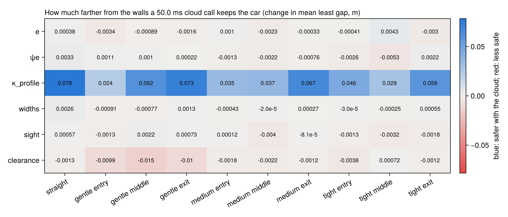

# What calling the cloud for one estimate buys

Each estimate from the car's network alone (its recorded errors), against the car's and the cloud's
together (the cloud's errors from the same recorded scans, the result arriving a delay after its scan,
fused by the Kalman filter as on the car); the other estimates true and on time. On 23
tracks, 10 seeds. From [`cloud.jl`](../cloud.jl), summed up by
[`report.jl`](../report.jl); 95% intervals in brackets. Left out: Shanghai, where the car crashes even with every estimate true and on time. A schedule would call
the cloud for an estimate where this buys the most:

### `e`

Per kind of situation: crashes per km and the least gap to a wall [m], the car's network alone and
with the cloud's at each delay; and what a call at 50.0 ms changes the least gap by
(positive: farther from the walls).

| Situation | Car alone: crashes/km | least gap | Cloud 25.0 ms: crashes/km | least gap | Cloud 50.0 ms: crashes/km | least gap | Cloud 100.0 ms: crashes/km | least gap | Gap change, cloud 50.0 ms |
|---|---|---|---|---|---|---|---|---|---|
| straight | 0.0 (0.0–0.069) | 0.7 (0.68–0.72) | 0.0 (0.0–0.069) | 0.7 (0.67–0.71) | 0.0 (0.0–0.069) | 0.7 (0.68–0.72) | 0.0 (0.0–0.069) | 0.7 (0.68–0.72) | 0.00038 (-0.028–0.027) |
| gentle entry | 0.0 (0.0–0.6) | 0.63 (0.61–0.64) | 0.0 (0.0–0.6) | 0.62 (0.61–0.64) | 0.0 (0.0–0.6) | 0.62 (0.61–0.64) | 0.0 (0.0–0.6) | 0.63 (0.61–0.64) | -0.0034 (-0.027–0.019) |
| gentle middle | 0.0 (0.0–0.32) | 0.58 (0.56–0.6) | 0.0 (0.0–0.32) | 0.58 (0.56–0.59) | 0.0 (0.0–0.32) | 0.58 (0.56–0.59) | 0.0 (0.0–0.32) | 0.58 (0.56–0.6) | -0.00089 (-0.023–0.022) |
| gentle exit | 0.0 (0.0–1.7) | 0.58 (0.56–0.6) | 0.0 (0.0–1.7) | 0.58 (0.56–0.6) | 0.0 (0.0–1.7) | 0.58 (0.56–0.6) | 0.0 (0.0–1.7) | 0.58 (0.56–0.6) | -0.0016 (-0.028–0.024) |
| medium entry | 0.0 (0.0–0.53) | 0.48 (0.46–0.49) | 0.0 (0.0–0.53) | 0.47 (0.46–0.49) | 0.0 (0.0–0.53) | 0.48 (0.46–0.49) | 0.0 (0.0–0.53) | 0.47 (0.46–0.49) | 0.001 (-0.017–0.018) |
| medium middle | 0.0 (0.0–1.6) | 0.48 (0.47–0.49) | 0.0 (0.0–1.6) | 0.48 (0.47–0.49) | 0.0 (0.0–1.6) | 0.48 (0.46–0.49) | 0.0 (0.0–1.6) | 0.48 (0.47–0.49) | -0.0023 (-0.019–0.014) |
| medium exit | 0.0 (0.0–1.4) | 0.47 (0.45–0.48) | 0.0 (0.0–1.4) | 0.46 (0.45–0.48) | 0.0 (0.0–1.4) | 0.46 (0.45–0.48) | 0.0 (0.0–1.4) | 0.47 (0.45–0.48) | -0.00033 (-0.021–0.019) |
| tight entry | 0.0 (0.0–0.84) | 0.45 (0.44–0.46) | 0.0 (0.0–0.84) | 0.45 (0.44–0.46) | 0.0 (0.0–0.84) | 0.45 (0.44–0.46) | 0.0 (0.0–0.84) | 0.45 (0.44–0.46) | -0.00041 (-0.019–0.017) |
| tight middle | 0.0 (0.0–24.0) | 0.46 (0.45–0.48) | 0.0 (0.0–25.0) | 0.47 (0.45–0.48) | 0.0 (0.0–25.0) | 0.47 (0.46–0.48) | 0.0 (0.0–25.0) | 0.47 (0.45–0.48) | 0.0043 (-0.014–0.024) |
| tight exit | 0.0 (0.0–2.8) | 0.45 (0.44–0.47) | 0.0 (0.0–2.8) | 0.45 (0.44–0.46) | 0.0 (0.0–2.8) | 0.45 (0.44–0.46) | 0.0 (0.0–2.8) | 0.45 (0.44–0.47) | -0.003 (-0.021–0.016) |
| **all** | 0.0 (0.0–0.041) | 0.44 (0.43–0.45) | 0.0 (0.0–0.041) | 0.44 (0.43–0.45) | 0.0 (0.0–0.041) | 0.44 (0.43–0.45) | 0.0 (0.0–0.041) | 0.44 (0.43–0.45) | -0.0013 (-0.02–0.018) |

### `ψe`

Per kind of situation: crashes per km and the least gap to a wall [m], the car's network alone and
with the cloud's at each delay; and what a call at 50.0 ms changes the least gap by
(positive: farther from the walls).

| Situation | Car alone: crashes/km | least gap | Cloud 25.0 ms: crashes/km | least gap | Cloud 50.0 ms: crashes/km | least gap | Cloud 100.0 ms: crashes/km | least gap | Gap change, cloud 50.0 ms |
|---|---|---|---|---|---|---|---|---|---|
| straight | 0.0 (0.0–0.069) | 0.69 (0.66–0.71) | 0.0 (0.0–0.069) | 0.69 (0.67–0.71) | 0.0 (0.0–0.069) | 0.69 (0.67–0.71) | 0.0 (0.0–0.069) | 0.69 (0.66–0.71) | 0.0033 (-0.027–0.032) |
| gentle entry | 0.0 (0.0–0.6) | 0.62 (0.6–0.64) | 0.0 (0.0–0.6) | 0.62 (0.61–0.64) | 0.0 (0.0–0.6) | 0.62 (0.61–0.64) | 0.0 (0.0–0.6) | 0.62 (0.61–0.64) | 0.0011 (-0.022–0.025) |
| gentle middle | 0.0 (0.0–0.32) | 0.57 (0.56–0.59) | 0.0 (0.0–0.32) | 0.57 (0.56–0.59) | 0.0 (0.0–0.32) | 0.57 (0.56–0.59) | 0.0 (0.0–0.32) | 0.58 (0.56–0.59) | 0.001 (-0.023–0.024) |
| gentle exit | 0.0 (0.0–1.7) | 0.57 (0.55–0.59) | 0.0 (0.0–1.7) | 0.57 (0.55–0.59) | 0.0 (0.0–1.7) | 0.57 (0.55–0.59) | 0.0 (0.0–1.7) | 0.57 (0.55–0.59) | 0.00022 (-0.026–0.025) |
| medium entry | 0.0 (0.0–0.53) | 0.47 (0.46–0.48) | 0.0 (0.0–0.53) | 0.47 (0.46–0.48) | 0.0 (0.0–0.53) | 0.47 (0.46–0.48) | 0.0 (0.0–0.53) | 0.47 (0.46–0.48) | -0.0013 (-0.02–0.015) |
| medium middle | 0.0 (0.0–1.6) | 0.47 (0.46–0.48) | 0.0 (0.0–1.6) | 0.47 (0.46–0.48) | 0.0 (0.0–1.6) | 0.47 (0.46–0.48) | 0.0 (0.0–1.6) | 0.47 (0.46–0.48) | -0.0022 (-0.019–0.014) |
| medium exit | 0.0 (0.0–1.4) | 0.47 (0.45–0.48) | 0.0 (0.0–1.4) | 0.46 (0.45–0.48) | 0.0 (0.0–1.4) | 0.46 (0.45–0.48) | 0.0 (0.0–1.4) | 0.47 (0.45–0.48) | -0.00076 (-0.023–0.02) |
| tight entry | 0.0 (0.0–0.84) | 0.45 (0.43–0.46) | 0.0 (0.0–0.84) | 0.44 (0.43–0.46) | 0.0 (0.0–0.84) | 0.44 (0.43–0.46) | 0.0 (0.0–0.84) | 0.45 (0.43–0.46) | -0.0026 (-0.022–0.014) |
| tight middle | 0.0 (0.0–24.0) | 0.47 (0.45–0.48) | 0.0 (0.0–24.0) | 0.46 (0.45–0.48) | 0.0 (0.0–25.0) | 0.46 (0.45–0.47) | 0.0 (0.0–24.0) | 0.46 (0.45–0.48) | -0.0053 (-0.024–0.014) |
| tight exit | 0.0 (0.0–2.8) | 0.44 (0.43–0.45) | 0.0 (0.0–2.8) | 0.44 (0.43–0.46) | 0.0 (0.0–2.8) | 0.44 (0.43–0.46) | 0.0 (0.0–2.8) | 0.44 (0.43–0.45) | 0.0022 (-0.017–0.02) |
| **all** | 0.0 (0.0–0.041) | 0.43 (0.42–0.44) | 0.0 (0.0–0.041) | 0.43 (0.42–0.44) | 0.0 (0.0–0.041) | 0.43 (0.42–0.44) | 0.0 (0.0–0.041) | 0.43 (0.42–0.44) | 0.00039 (-0.019–0.019) |

### `κ_profile`

Per kind of situation: crashes per km and the least gap to a wall [m], the car's network alone and
with the cloud's at each delay; and what a call at 50.0 ms changes the least gap by
(positive: farther from the walls).

| Situation | Car alone: crashes/km | least gap | Cloud 25.0 ms: crashes/km | least gap | Cloud 50.0 ms: crashes/km | least gap | Cloud 100.0 ms: crashes/km | least gap | Gap change, cloud 50.0 ms |
|---|---|---|---|---|---|---|---|---|---|
| straight | 0.019 (0.00048–0.11) | 0.6 (0.57–0.63) | 0.0 (0.0–0.069) | 0.7 (0.68–0.72) | 0.0 (0.0–0.069) | 0.68 (0.65–0.7) | 0.0 (0.0–0.069) | 0.65 (0.62–0.68) | 0.078 (0.037–0.12) |
| gentle entry | 0.0 (0.0–0.61) | 0.6 (0.59–0.62) | 0.0 (0.0–0.6) | 0.63 (0.61–0.64) | 0.0 (0.0–0.6) | 0.63 (0.61–0.64) | 0.0 (0.0–0.6) | 0.62 (0.6–0.63) | 0.024 (7.4e-5–0.047) |
| gentle middle | 0.0 (0.0–0.32) | 0.51 (0.49–0.53) | 0.0 (0.0–0.32) | 0.58 (0.56–0.59) | 0.0 (0.0–0.32) | 0.57 (0.55–0.59) | 0.0 (0.0–0.32) | 0.56 (0.54–0.58) | 0.062 (0.033–0.091) |
| gentle exit | 0.47 (0.012–2.6) | 0.5 (0.47–0.53) | 0.0 (0.0–1.7) | 0.58 (0.56–0.6) | 0.0 (0.0–1.7) | 0.57 (0.55–0.59) | 0.0 (0.0–1.7) | 0.55 (0.52–0.57) | 0.073 (0.039–0.11) |
| medium entry | 0.14 (0.0036–0.8) | 0.42 (0.4–0.43) | 0.0 (0.0–0.53) | 0.46 (0.44–0.47) | 0.0 (0.0–0.53) | 0.45 (0.44–0.46) | 0.0 (0.0–0.53) | 0.44 (0.43–0.45) | 0.035 (0.016–0.054) |
| medium middle | 0.0 (0.0–1.6) | 0.42 (0.41–0.43) | 0.0 (0.0–1.6) | 0.47 (0.45–0.48) | 0.0 (0.0–1.6) | 0.46 (0.45–0.47) | 0.0 (0.0–1.6) | 0.45 (0.43–0.46) | 0.037 (0.019–0.055) |
| medium exit | 0.77 (0.094–2.8) | 0.37 (0.35–0.39) | 0.0 (0.0–1.4) | 0.44 (0.43–0.46) | 0.0 (0.0–1.4) | 0.44 (0.43–0.45) | 0.0 (0.0–1.4) | 0.42 (0.4–0.44) | 0.067 (0.043–0.091) |
| tight entry | 0.93 (0.25–2.4) | 0.41 (0.4–0.43) | 0.0 (0.0–0.85) | 0.46 (0.45–0.48) | 0.0 (0.0–0.84) | 0.46 (0.44–0.47) | 0.0 (0.0–0.84) | 0.45 (0.44–0.46) | 0.046 (0.025–0.066) |
| tight middle | 19.0 (3.9–56.0) | 0.47 (0.45–0.49) | 0.0 (0.0–23.0) | 0.5 (0.48–0.51) | 0.0 (0.0–23.0) | 0.5 (0.49–0.52) | 0.0 (0.0–24.0) | 0.51 (0.49–0.52) | 0.029 (0.0071–0.052) |
| tight exit | 0.0 (0.0–2.9) | 0.39 (0.37–0.41) | 0.0 (0.0–2.8) | 0.45 (0.44–0.46) | 0.0 (0.0–2.8) | 0.45 (0.44–0.46) | 0.0 (0.0–2.8) | 0.43 (0.42–0.45) | 0.059 (0.035–0.083) |
| **all** | 0.13 (0.069–0.23) | 0.34 (0.32–0.36) | 0.0 (0.0–0.041) | 0.43 (0.41–0.44) | 0.0 (0.0–0.041) | 0.42 (0.41–0.44) | 0.0 (0.0–0.041) | 0.4 (0.38–0.41) | 0.081 (0.056–0.1) |

### `widths`

Per kind of situation: crashes per km and the least gap to a wall [m], the car's network alone and
with the cloud's at each delay; and what a call at 50.0 ms changes the least gap by
(positive: farther from the walls).

| Situation | Car alone: crashes/km | least gap | Cloud 25.0 ms: crashes/km | least gap | Cloud 50.0 ms: crashes/km | least gap | Cloud 100.0 ms: crashes/km | least gap | Gap change, cloud 50.0 ms |
|---|---|---|---|---|---|---|---|---|---|
| straight | 0.0 (0.0–0.069) | 0.67 (0.65–0.7) | 0.0 (0.0–0.069) | 0.68 (0.65–0.7) | 0.0 (0.0–0.069) | 0.68 (0.65–0.7) | 0.0 (0.0–0.069) | 0.67 (0.65–0.7) | 0.0026 (-0.028–0.032) |
| gentle entry | 0.0 (0.0–0.6) | 0.63 (0.61–0.64) | 0.0 (0.0–0.6) | 0.63 (0.61–0.64) | 0.0 (0.0–0.6) | 0.63 (0.61–0.64) | 0.0 (0.0–0.6) | 0.63 (0.61–0.64) | -0.00091 (-0.024–0.022) |
| gentle middle | 0.0 (0.0–0.32) | 0.57 (0.56–0.59) | 0.0 (0.0–0.32) | 0.57 (0.56–0.59) | 0.0 (0.0–0.32) | 0.57 (0.56–0.59) | 0.0 (0.0–0.32) | 0.57 (0.56–0.59) | -0.00077 (-0.024–0.023) |
| gentle exit | 0.0 (0.0–1.7) | 0.57 (0.55–0.59) | 0.0 (0.0–1.7) | 0.57 (0.55–0.59) | 0.0 (0.0–1.7) | 0.57 (0.55–0.59) | 0.0 (0.0–1.7) | 0.57 (0.55–0.59) | 0.0013 (-0.026–0.027) |
| medium entry | 0.0 (0.0–0.53) | 0.47 (0.46–0.49) | 0.0 (0.0–0.53) | 0.47 (0.46–0.49) | 0.0 (0.0–0.53) | 0.47 (0.46–0.48) | 0.0 (0.0–0.53) | 0.47 (0.46–0.49) | -0.00043 (-0.019–0.016) |
| medium middle | 0.0 (0.0–1.6) | 0.47 (0.46–0.48) | 0.0 (0.0–1.6) | 0.47 (0.46–0.48) | 0.0 (0.0–1.6) | 0.47 (0.46–0.48) | 0.0 (0.0–1.6) | 0.47 (0.46–0.48) | -2.0e-5 (-0.017–0.016) |
| medium exit | 0.0 (0.0–1.4) | 0.46 (0.45–0.48) | 0.0 (0.0–1.4) | 0.46 (0.45–0.48) | 0.0 (0.0–1.4) | 0.46 (0.45–0.48) | 0.0 (0.0–1.4) | 0.46 (0.45–0.48) | 0.00027 (-0.02–0.019) |
| tight entry | 0.0 (0.0–0.84) | 0.45 (0.43–0.46) | 0.0 (0.0–0.84) | 0.45 (0.43–0.46) | 0.0 (0.0–0.84) | 0.45 (0.43–0.46) | 0.0 (0.0–0.84) | 0.45 (0.43–0.46) | -3.0e-5 (-0.02–0.018) |
| tight middle | 0.0 (0.0–23.0) | 0.47 (0.46–0.49) | 0.0 (0.0–23.0) | 0.47 (0.46–0.49) | 0.0 (0.0–23.0) | 0.47 (0.46–0.49) | 0.0 (0.0–23.0) | 0.47 (0.46–0.49) | -0.00025 (-0.02–0.018) |
| tight exit | 0.0 (0.0–2.8) | 0.45 (0.44–0.47) | 0.0 (0.0–2.8) | 0.45 (0.44–0.47) | 0.0 (0.0–2.8) | 0.45 (0.44–0.47) | 0.0 (0.0–2.8) | 0.45 (0.44–0.47) | 0.00055 (-0.021–0.02) |
| **all** | 0.0 (0.0–0.041) | 0.44 (0.43–0.45) | 0.0 (0.0–0.041) | 0.44 (0.43–0.45) | 0.0 (0.0–0.041) | 0.44 (0.43–0.45) | 0.0 (0.0–0.041) | 0.44 (0.43–0.45) | -0.00038 (-0.019–0.018) |

### `sight`

Per kind of situation: crashes per km and the least gap to a wall [m], the car's network alone and
with the cloud's at each delay; and what a call at 50.0 ms changes the least gap by
(positive: farther from the walls).

| Situation | Car alone: crashes/km | least gap | Cloud 25.0 ms: crashes/km | least gap | Cloud 50.0 ms: crashes/km | least gap | Cloud 100.0 ms: crashes/km | least gap | Gap change, cloud 50.0 ms |
|---|---|---|---|---|---|---|---|---|---|
| straight | 0.0 (0.0–0.069) | 0.7 (0.68–0.72) | 0.0 (0.0–0.069) | 0.7 (0.68–0.72) | 0.0 (0.0–0.069) | 0.7 (0.68–0.72) | 0.0 (0.0–0.069) | 0.7 (0.68–0.72) | 0.00057 (-0.028–0.027) |
| gentle entry | 0.0 (0.0–0.6) | 0.63 (0.61–0.64) | 0.0 (0.0–0.6) | 0.62 (0.61–0.64) | 0.0 (0.0–0.6) | 0.63 (0.61–0.64) | 0.0 (0.0–0.6) | 0.63 (0.61–0.64) | -0.0013 (-0.024–0.021) |
| gentle middle | 0.0 (0.0–0.32) | 0.58 (0.56–0.59) | 0.0 (0.0–0.32) | 0.58 (0.56–0.6) | 0.0 (0.0–0.32) | 0.58 (0.56–0.6) | 0.0 (0.0–0.32) | 0.58 (0.56–0.59) | 0.0022 (-0.021–0.025) |
| gentle exit | 0.0 (0.0–1.7) | 0.58 (0.56–0.6) | 0.0 (0.0–1.7) | 0.58 (0.56–0.6) | 0.0 (0.0–1.7) | 0.58 (0.56–0.6) | 0.0 (0.0–1.7) | 0.58 (0.56–0.6) | 0.00073 (-0.025–0.025) |
| medium entry | 0.0 (0.0–0.53) | 0.48 (0.47–0.49) | 0.0 (0.0–0.53) | 0.47 (0.46–0.49) | 0.0 (0.0–0.53) | 0.48 (0.47–0.49) | 0.0 (0.0–0.53) | 0.48 (0.47–0.49) | 0.00012 (-0.018–0.017) |
| medium middle | 0.0 (0.0–1.6) | 0.48 (0.47–0.49) | 0.0 (0.0–1.6) | 0.48 (0.46–0.49) | 0.0 (0.0–1.6) | 0.48 (0.46–0.49) | 0.0 (0.0–1.6) | 0.48 (0.46–0.49) | -0.004 (-0.021–0.013) |
| medium exit | 0.0 (0.0–1.4) | 0.46 (0.45–0.48) | 0.0 (0.0–1.4) | 0.46 (0.45–0.48) | 0.0 (0.0–1.4) | 0.46 (0.45–0.48) | 0.0 (0.0–1.4) | 0.46 (0.45–0.48) | -8.1e-5 (-0.02–0.018) |
| tight entry | 0.0 (0.0–0.85) | 0.45 (0.44–0.46) | 0.0 (0.0–0.85) | 0.45 (0.44–0.46) | 0.0 (0.0–0.84) | 0.45 (0.44–0.46) | 0.0 (0.0–0.84) | 0.45 (0.44–0.46) | -0.0013 (-0.02–0.015) |
| tight middle | 0.0 (0.0–24.0) | 0.47 (0.46–0.48) | 0.0 (0.0–24.0) | 0.47 (0.45–0.48) | 0.0 (0.0–24.0) | 0.47 (0.46–0.48) | 0.0 (0.0–24.0) | 0.47 (0.46–0.48) | -0.0032 (-0.02–0.013) |
| tight exit | 0.0 (0.0–2.8) | 0.44 (0.43–0.46) | 0.0 (0.0–2.9) | 0.44 (0.43–0.45) | 0.0 (0.0–2.8) | 0.44 (0.43–0.46) | 0.0 (0.0–2.8) | 0.44 (0.43–0.46) | -0.0018 (-0.02–0.016) |
| **all** | 0.0 (0.0–0.041) | 0.43 (0.42–0.45) | 0.0 (0.0–0.041) | 0.43 (0.42–0.45) | 0.0 (0.0–0.041) | 0.43 (0.42–0.44) | 0.0 (0.0–0.041) | 0.43 (0.42–0.45) | -0.0024 (-0.02–0.016) |

### `clearance`

Per kind of situation: crashes per km and the least gap to a wall [m], the car's network alone and
with the cloud's at each delay; and what a call at 50.0 ms changes the least gap by
(positive: farther from the walls).

| Situation | Car alone: crashes/km | least gap | Cloud 25.0 ms: crashes/km | least gap | Cloud 50.0 ms: crashes/km | least gap | Cloud 100.0 ms: crashes/km | least gap | Gap change, cloud 50.0 ms |
|---|---|---|---|---|---|---|---|---|---|
| straight | 0.0 (0.0–0.069) | 0.71 (0.69–0.73) | 0.0 (0.0–0.069) | 0.7 (0.68–0.72) | 0.0 (0.0–0.069) | 0.71 (0.68–0.73) | 0.0 (0.0–0.069) | 0.71 (0.69–0.73) | -0.0013 (-0.031–0.026) |
| gentle entry | 0.0 (0.0–0.6) | 0.64 (0.63–0.66) | 0.0 (0.0–0.6) | 0.63 (0.61–0.65) | 0.0 (0.0–0.6) | 0.63 (0.62–0.65) | 0.0 (0.0–0.6) | 0.64 (0.62–0.65) | -0.0099 (-0.033–0.012) |
| gentle middle | 0.0 (0.0–0.32) | 0.6 (0.59–0.62) | 0.0 (0.0–0.32) | 0.59 (0.57–0.6) | 0.0 (0.0–0.32) | 0.59 (0.57–0.6) | 0.0 (0.0–0.32) | 0.59 (0.58–0.61) | -0.015 (-0.038–0.0087) |
| gentle exit | 0.0 (0.0–1.7) | 0.59 (0.57–0.61) | 0.0 (0.0–1.7) | 0.57 (0.56–0.59) | 0.0 (0.0–1.7) | 0.58 (0.56–0.6) | 0.0 (0.0–1.7) | 0.58 (0.57–0.6) | -0.01 (-0.036–0.014) |
| medium entry | 0.0 (0.0–0.53) | 0.48 (0.47–0.5) | 0.0 (0.0–0.53) | 0.48 (0.47–0.49) | 0.0 (0.0–0.53) | 0.48 (0.47–0.49) | 0.0 (0.0–0.53) | 0.48 (0.47–0.49) | -0.0018 (-0.021–0.016) |
| medium middle | 0.0 (0.0–1.6) | 0.48 (0.47–0.5) | 0.0 (0.0–1.6) | 0.48 (0.47–0.49) | 0.0 (0.0–1.6) | 0.48 (0.47–0.49) | 0.0 (0.0–1.6) | 0.49 (0.47–0.5) | -0.0022 (-0.019–0.015) |
| medium exit | 0.0 (0.0–1.4) | 0.47 (0.46–0.48) | 0.0 (0.0–1.4) | 0.47 (0.45–0.48) | 0.0 (0.0–1.4) | 0.47 (0.45–0.48) | 0.0 (0.0–1.4) | 0.47 (0.46–0.49) | -0.0012 (-0.021–0.018) |
| tight entry | 0.0 (0.0–0.85) | 0.46 (0.44–0.47) | 0.0 (0.0–0.84) | 0.45 (0.44–0.47) | 0.0 (0.0–0.85) | 0.45 (0.44–0.47) | 0.0 (0.0–0.84) | 0.46 (0.44–0.47) | -0.0038 (-0.023–0.014) |
| tight middle | 0.0 (0.0–24.0) | 0.47 (0.46–0.48) | 0.0 (0.0–25.0) | 0.47 (0.46–0.48) | 0.0 (0.0–24.0) | 0.47 (0.46–0.48) | 0.0 (0.0–24.0) | 0.48 (0.46–0.49) | 0.00072 (-0.017–0.019) |
| tight exit | 0.0 (0.0–2.9) | 0.45 (0.44–0.46) | 0.0 (0.0–2.8) | 0.45 (0.44–0.46) | 0.0 (0.0–2.8) | 0.45 (0.44–0.46) | 0.0 (0.0–2.9) | 0.45 (0.44–0.47) | -0.0012 (-0.02–0.017) |
| **all** | 0.0 (0.0–0.041) | 0.44 (0.43–0.46) | 0.0 (0.0–0.041) | 0.44 (0.43–0.46) | 0.0 (0.0–0.041) | 0.44 (0.43–0.45) | 0.0 (0.0–0.041) | 0.45 (0.43–0.46) | -0.0041 (-0.023–0.015) |
