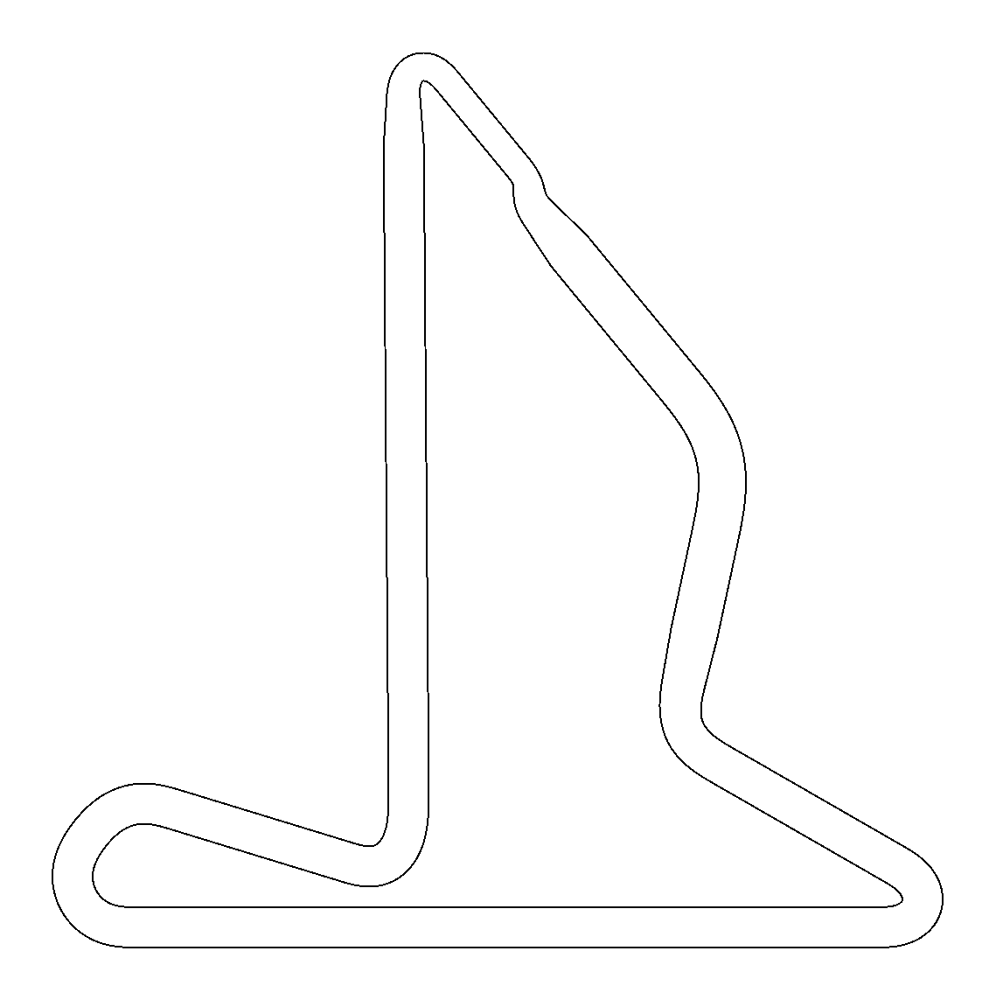

# The representative track

One closed track, 179.6 m long, built from pieces of known curvature and width
(TrajectorySensitivity.jl's `TrackDesign`; the design is in [`track.jl`](../track.jl)) so that it has
every kind of situation the 23 f1tenth_racetracks tracks have, each at least once, and nothing they
don't: a long straight into a hairpin, the median corner, a fast sweeper, a chicane, a tight hairpin, a
tightening corner and a double apex; the lane as narrow, as wide and as usual as on the real tracks,
changing from one to the other (the real tracks each keep one width). Left and right turns. The
same thin walls on free ground as the real maps, 0.05 m per pixel.

Measured the same way on both (every 0.25 m of the centerline: curvature through points 1 m apart,
lane width from the map; straights: runs with |κ| < 0.03 1/m longer than 2 m; corners: runs with
|κ| > 0.08 1/m of one sign turning more than 0.3 rad). The representative track covers the real
tracks' range; it has a larger share of corners, since each situation is there once and the real
tracks are mostly straight.

| Track | Length [m] | \|κ\| 50 / 75 / 90 / 99% [1/m] | max \|κ\| | width 1 / 50 / 99% [m] | straights: n: length 50 / 90 / 100% [m] | corner peak \|κ\| 10 / 50 / 90 / 100% | corner turn 50 / 90 / 100% [rad] |
|---|---|---|---|---|---|---|---|
| all 23 racetracks | 9218 | 0.01 / 0.07 / 0.19 / 0.66 | 1.74 | 1.46 / 2.26 / 2.66 | 301: 11.25 / 38.00 / 108.25 | 0.15 / 0.39 / 1.03 / 1.74 | 1.26 / 2.46 / 4.99 |
| Representative | 180 | 0.00 / 0.06 / 0.31 / 0.74 | 1.02 | 1.51 / 2.23 / 2.65 | 7: 11.25 / 40.60 / 42.25 | 0.30 / 0.51 / 0.83 / 1.02 | 1.50 / 2.82 / 3.39 |

Its segments, in driving order from the start line (the situations the results are grouped by):

| Segment | Starts at [m] | Length [m] |
|---|---|---|
| long straight | 0.0 | 42.0 |
| hairpin | 42.0 | 6.5 |
| straight | 48.5 | 11.0 |
| medium corner | 59.5 | 6.2 |
| straight | 65.7 | 8.0 |
| fast sweeper | 73.7 | 10.0 |
| straight | 83.7 | 12.0 |
| chicane | 95.7 | 3.3 |
| straight | 99.0 | 6.0 |
| tight hairpin | 105.0 | 4.5 |
| straight | 109.5 | 39.3 |
| tightening corner | 148.8 | 7.0 |
| straight | 155.8 | 10.0 |
| double apex | 165.8 | 13.8 |
